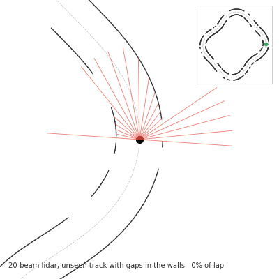
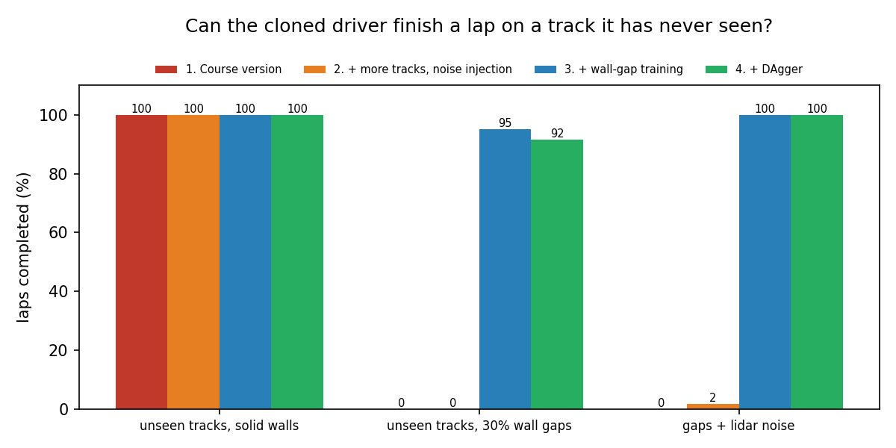
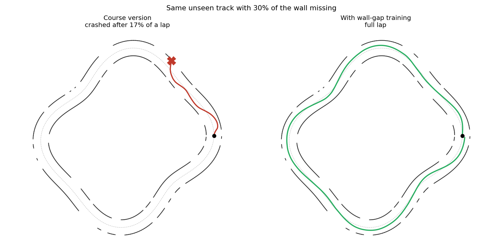

# Behavior Cloning Driver

[](https://github.com/Abdelrahman-521/behavior-cloning-driver/actions/workflows/ci.yml)

A robot learns to drive around a track by copying an expert, using nothing but a 20-beam lidar. Then the question my robotics course left open: **what happens on a track it has never seen, and how do you fix it?**



## The result

The driver trained the way the course assignment did it drives perfectly on new tracks with solid walls. Put **gaps in the walls**, though, and it can't finish a lap. Training on walls with random gaps fixes it.



| Driver | Unseen tracks, solid walls | Unseen tracks, 30% wall gaps | Gaps + lidar noise |
|---|---|---|---|
| Expert (cheats: reads the true track geometry) | 95% | 100% | 100% |
| 1. Course version | **100%** | **0%** | 0% |
| 2. + more tracks, noise injection, better training | 100% | 0% | 2% |
| 3. + wall-gap training | 100% | **95%** | 100% |
| 4. + DAgger (4 rounds) | 100% | 92% | 100% |

*Laps completed without touching a wall. Each cell is 60 runs: 20 tracks the driver never trained on, 3 random starts each. The expert misses one solid-wall track whose hairpin is too tight at its speed.*



**What I learned from it**

- **The gap problem came from the training data, not the network.** Through a gap the lidar reads full range, which looks exactly like open road. The course driver had only ever seen solid walls, so it drove out through the gaps (the red X above). More tracks and noise injection (driver 2) didn't help, because none of that data had gaps either.
- **Domain randomisation fixed it.** Training on walls with random gaps (driver 3) took lap completion from 0% to 95%. It also made the driver robust to lidar noise it was never trained on.
- **DAgger didn't add anything here.** DAgger lets the learner drive and asks the expert to label the states it reaches. It's the textbook fix for small mistakes that snowball. Here it scored 92% against 95% on the gap tracks, which is within the noise of 60 runs. Driver 3's three crashes all happen on one track, on the inside of curves where most of the nearby wall is missing, so the lidar has almost nothing to steer by. That's a sensing limit, not snowballing mistakes.

## How it works

| File | What it does |
|---|---|
| [`bcdrive/track.py`](bcdrive/track.py) | Random closed tracks (a circle bent by two sine waves), walls with optional gaps, and the geometry queries: nearest centreline point, heading error, cross-track error |
| [`bcdrive/robot.py`](bcdrive/robot.py) | Differential-drive kinematics and a vectorised 20-beam lidar (ray–segment intersection against the nearby walls only) |
| [`bcdrive/expert.py`](bcdrive/expert.py) | The expert: steers from the exact heading and cross-track error, and slows down when misaligned |
| [`bcdrive/policy.py`](bcdrive/policy.py) | The network and its training: the course training loop, plus an improved one with scaled inputs, mini-batches, a validation split and early stopping |
| [`bcdrive/sim.py`](bcdrive/sim.py) | Collecting demonstrations (teleports, noise injection), DAgger data, driving a lap and scoring it |
| [`experiments/run_all.py`](experiments/run_all.py) | Reproduces every number and figure above |

The network sees 21 numbers: the 20 lidar distances plus the robot's heading error relative to the track. The course used that same extra input, because without it the network can't tell which way round the loop to drive. It outputs a forward speed and a turn rate.

## Run it

```bash
pip install -r requirements.txt
python experiments/run_all.py     # about 5 minutes on a laptop CPU; writes results/
pytest                            # 10 tests: geometry, lidar, expert, data collection, training
```

## Where this came from

**Winter 2026, COMP 4766 (Introduction to Autonomous Robotics), Memorial University, Assignment 6.** The instructor provided the simulator setup, the expert controller and the data-capture and test scripts. My job was the training: a one-hidden-layer PyTorch network trained with Adam on mean-squared error for 100 epochs to imitate the expert. That loop is kept here as `train_course_style` in [`bcdrive/policy.py`](bcdrive/policy.py), and it's what driver 1 uses. The assignment ended by suggesting a second track "where degraded performance is expected", and left improving generalisation as an open question.

**October 2026.** After graduating I took the project further using agentic automation. Starting from my assignment code, I directed an AI coding agent (Claude Code) to rebuild it as a standalone repo with its own simulator, so it runs anywhere without the course files, and then took on the generalisation question. None of the instructor's files are included.

## Tech
Python · PyTorch · NumPy · Matplotlib · imitation learning (behavior cloning, DAgger, domain randomisation) · pytest · GitHub Actions
